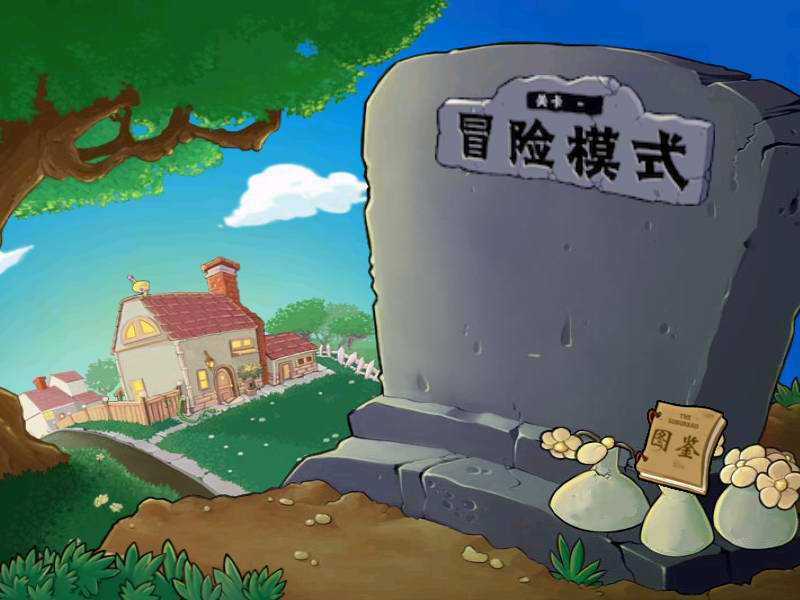
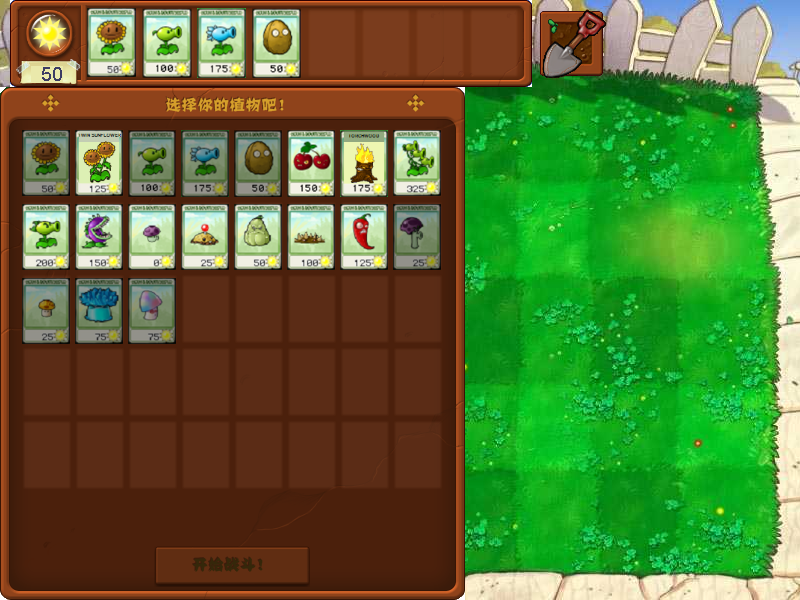
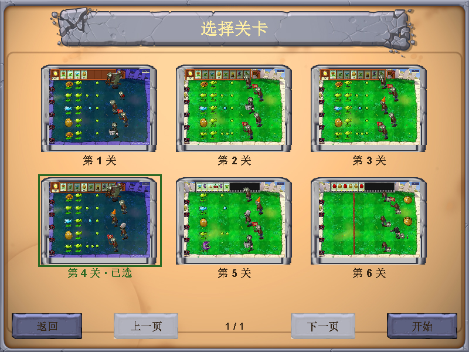
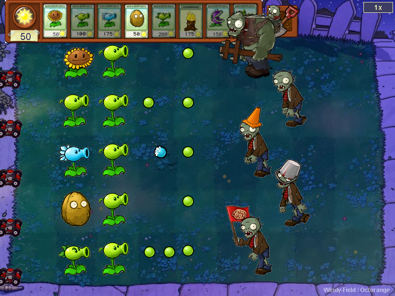
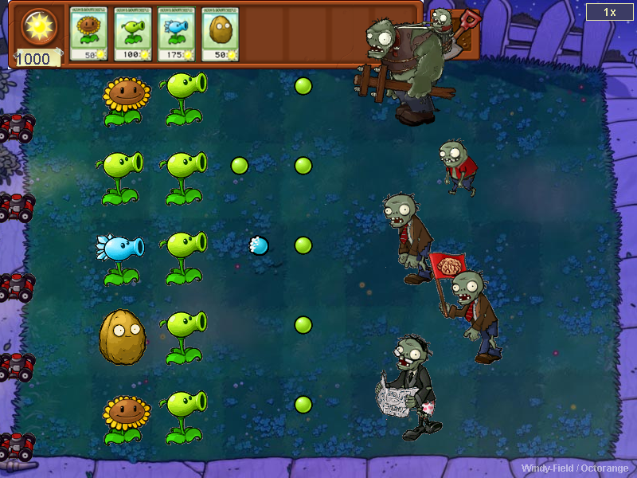
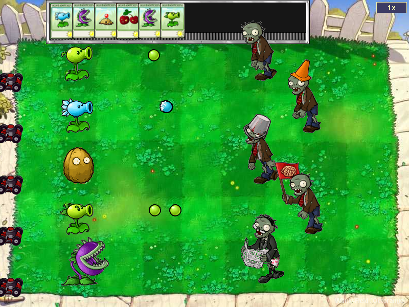
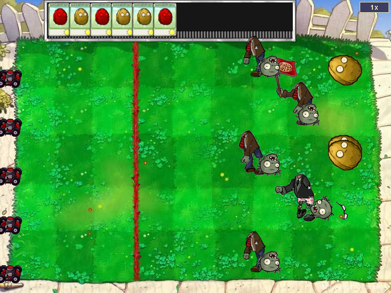
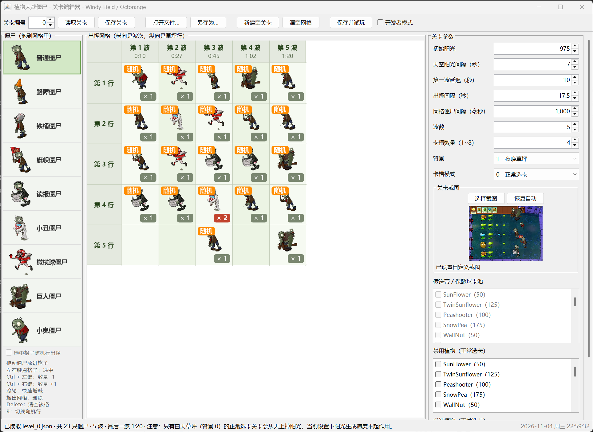
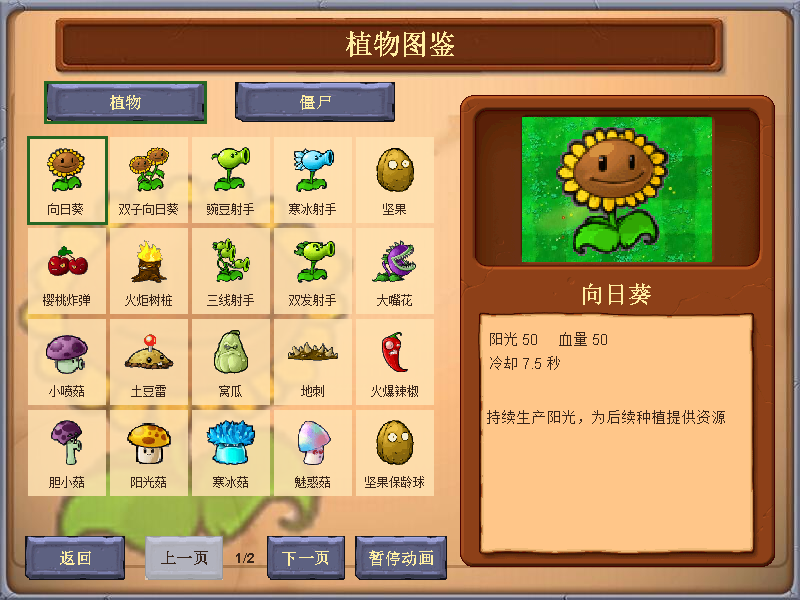
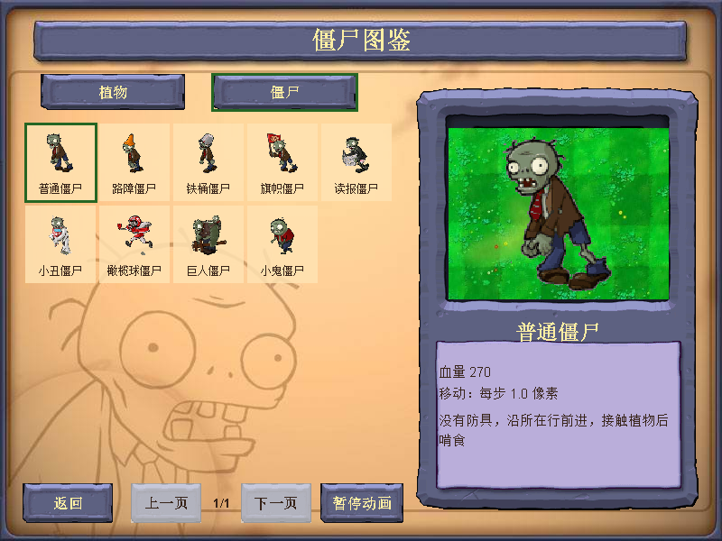

# 植物大战僵尸（Java 版）

这是一个使用 Java Swing 编写的植物大战僵尸学习项目。项目包含冒险模式、传送带关卡、坚果保龄球关卡和图形化关卡编辑器，适合学习 Java 桌面程序、游戏循环、动画播放、碰撞检测和 JSON 文件读写。

本项目代码规模较小，非常适合大一~大二阅读、参考。

**本项目仅能用于学习，禁止商用，严禁抄袭！**

作者：**Windy-Field / Octorange**

## 游戏截图

| 主菜单 | 选卡界面 |
| --- | --- |
|  |  |

| 关卡选择 | 第 4 关 |
| --- | --- |
|  |  |

| 经典关卡 | 传送带关卡 |
| --- | --- |
|  |  |

| 坚果保龄球关卡 | 关卡编辑器 |
| --- | --- |
|  |  |

| 植物图鉴 | 僵尸图鉴 |
| --- | --- |
|  |  |

## 当前版本

### V1.9

- **关卡与导航**：编辑器支持截图封面选关、双击进入，以及关卡内返回选关
- **植物与僵尸图鉴**：主菜单可查看全部已实现品种的 GIF 动画、数值和能力介绍，支持暂停
- **新增战斗内容**：加入巨人僵尸和小鬼僵尸
- **增加豌豆伤害**：普通、冰豌豆及蘑菇子弹伤害由 20 提升为 25，火焰豌豆由 40 提升为 50
- **重要修复**：修正吞咽与爆炸死亡效果、传送带入场时序和卡片重叠

详细数值与实现说明请移步至 [战斗数值设计](docs/combat-values.md)和[游戏界面设计](docs/interface-design.md)。

## 历史更新

### V1.8

- 增加铲子卡槽。点击植物可以移除植物，点击空草坪格会自动收回铲子，右键可以取消操作。
- 增加橄榄球僵尸。
- 优化窝瓜索敌，优先攻击近处目标，并压扁落点附近的僵尸。

### V1.7

- 增加双发向日葵。每次生产阳光时会生成两颗阳光。

### V1.6

- 增加火炬树桩、火焰豌豆和子弹转换规则。
- 普通豌豆经过火炬树桩后会变成火焰豌豆；冰豌豆经过火炬树桩后会恢复为普通豌豆。

### V1.5 及更早版本

- 增加 1x、1.5x、2x 三档战斗速度，并使用固定时间步长推进战斗。
- 增加小丑僵尸、传送带关卡、坚果保龄球关卡和图形化关卡编辑器。
- 增加开场演出、阳光收集、卡片冷却和小推车防线等基础机制。

## 快速开始

使用 Windows 和 JDK 17 或更高版本，保留完整素材，在项目根目录运行：

```bat
run.bat            :: 从第 1 关开始
run.bat 3          :: 从第 4 关开始，参数 0~5 对应第 1~6 关
run.bat test       :: 运行自检
run.bat editor     :: 打开关卡编辑器并载入第 1 关
run.bat editor 3   :: 打开关卡编辑器并载入第 4 关
```

进入游戏后点击“冒险模式”打开选关页，命令行关卡参数用于设置默认选中项；编辑器试玩直接载入指定关卡。

游戏入口是 `src/main/java/pvz/Main.java`，编辑器入口是 `src/main/java/pvz/EditorMain.java`。

## 素材目录

```text
assets/
├── Cards/       植物卡片
├── Map/         关卡背景
├── Plants/      植物动画
├── Screen/      菜单和界面图片
├── Zombies/     僵尸动画
├── bullets/     子弹图片
├── new_assets/  新增素材、重复素材和待删除素材
└── levels/      关卡文件 level_0.json ~ level_5.json
```

素材缺失或损坏时，请运行 `run.bat test`。自检程序会检查素材、资料表、动画和关卡文件是否能够正常使用。

新增素材的英文命名、重复比对和筛选结果见 [`docs/asset-import/README.md`](docs/asset-import/README.md)。
以后可以新增的植物和僵尸技能见 [`docs/asset-import/creative-skills.md`](docs/asset-import/creative-skills.md)。

## 自检程序

`run.bat test` 会在不打开游戏窗口的情况下运行 `SelfCheckTest`。它会检查以下内容：

- 界面图片、背景、植物素材和僵尸素材；
- 植物与僵尸资料表、卡片、动画和基础行为；
- 橄榄球僵尸的速度、动画和死亡流程；
- 巨人的砸击、半血投掷、冻结、小鬼飞行落地、专属死亡和编辑器读写；
- 窝瓜的索敌、锁定目标和多目标压扁范围；
- 铲子、传送带、保龄球、选卡、种植和出怪流程；
- 关卡编辑器的保存、读取和游戏侧加载；
- 游戏渲染结果和固定时间步长。

全部通过时，程序会输出 `PASS`，并把测试画面保存到 `build/`。自检会临时使用 `assets/levels/level_99.json`，使用前会检查该文件是否已经存在，结束后会删除临时文件。

## 关卡编辑器


编辑器的网格横向表示波次，纵向表示草坪的 5 行。每个格子表示某一波在某一行出现的僵尸以及出现数量。

| 操作 | 作用 |
| --- | --- |
| 将僵尸拖入格子 | 在格子中添加僵尸 |
| 点击格子 | 选中格子 |
| Ctrl + 左键 / Ctrl + 右键 | 减少 / 增加僵尸数量 |
| 滚轮 | 快速调整僵尸数量 |
| 将格子拖到其他格子 | 移动内容；目标格有内容时会交换 |
| 将格子拖出网格或按 Delete | 删除格子中的僵尸 |
| 按 R 或勾选“随机行出怪” | 让这一波的僵尸随机选择行 |

编辑器可以设置初始阳光、阳光生成间隔、出怪间隔、卡槽数量、卡池、禁用植物和必选植物。卡槽数量的范围是 1~8；禁用植物和必选植物只对正常选卡关卡生效。

右侧“关卡截图”区域可选择 PNG、JPG 或 GIF 图片作为选关封面，设置后需保存关卡。点击“恢复自动”并保存可改回自动封面，截图导入位置与回退规则见 [游戏界面设计](docs/interface-design.md)。

点击“保存并试玩”可以在新窗口中运行当前关卡。勾选“开发者模式”后，试玩画面会显示碰撞箱、血量和场上对象数量；该设置不会写入关卡文件。

## 游戏操作

| 操作 | 作用 |
| --- | --- |
| 点击植物卡片，再点击草坪 | 种植植物 |
| 点击铲子，再点击植物 | 移除植物 |
| 点击空草坪格 | 收回铲子 |
| 鼠标右键 | 取消手中的卡片或铲子 |
| 点击右上角速度按钮 | 切换 1x、1.5x、2x 战斗速度 |

## 项目结构

源码放在 `src/`，素材放在 `assets/`，说明放在 `docs/`，展示截图放在 `screenshots/`。`scripts/` 保存运行和打包共用的构建工具。

`build/` 保存编译结果和自检截图，`target/` 是 Maven 生成的目录，`dist/` 保存发行包。

```text
src/main/java/pvz/
├── Main.java                     游戏入口
├── EditorMain.java               关卡编辑器入口
├── plant/                        植物资料、卡片和行为
│   ├── BulletTransformation.java 子弹转换资料
│   ├── Card.java                 卡片对象
│   ├── Cards.java                卡槽卡片生成
│   ├── CloseAttackActions.java   近战与保龄球植物行为
│   ├── InstantPlantActions.java  一次性植物行为
│   ├── Plant.java                植物对象
│   ├── PlantActionType.java      植物行为类别
│   ├── PlantActions.java         植物行为调度与坚果换图
│   ├── PlantCatalog.java         植物资料表
│   ├── PlantDefinition.java      单种植物资料
│   ├── ShooterActions.java       射手植物行为
│   └── SunProducerActions.java   产阳光植物行为
├── zombie/                       僵尸资料、出场和效果
│   ├── Zombie.java               僵尸对象
│   ├── ZombieActions.java        普通动作、巨人砸击与投掷、小鬼飞行
│   ├── ZombieCatalog.java        僵尸资料表
│   ├── ZombieDefinition.java     单种僵尸资料
│   ├── ZombieEffects.java        僵尸死亡和特殊效果
│   └── ZombieSpawn.java          僵尸出场记录
├── game/                         游戏流程和战斗系统
│   ├── Almanac.java              图鉴浏览、动画和分页
│   ├── AlmanacDescriptions.java  按内部名称查询的中文介绍
│   ├── LevelSelection.java       选关布局、翻页与输入
│   ├── LevelPreview.java         实际关卡资料生成的封面
│   ├── CombatSystem.java         战斗对象更新
│   ├── Game.java                 游戏主流程与输入处理
│   ├── GameRenderer.java         游戏画面绘制
│   ├── GameScreen.java           游戏画面状态
│   ├── GameState.java            当前游戏数据
│   └── LevelSystem.java          关卡出怪和通关流程
├── level/                        关卡数据和 JSON 读写
│   ├── Level.java                关卡数据
│   ├── LevelJson.java            关卡 JSON 格式约定
│   ├── LevelLoader.java          读取关卡文件和发现编号
│   └── LevelScreenshot.java      截图导入和读取
├── world/                        素材、坐标和公共对象
│   ├── Assets.java               图片与动画加载
│   ├── Bullet.java               子弹对象
│   ├── Car.java                  小推车对象
│   ├── Layout.java               坐标、时间、血量、伤害和界面常量
│   ├── Sprite.java               游戏对象基类
│   └── Sun.java                  阳光对象
├── tools/
│   ├── AssetToolkit.java         图片处理工具
│   └── TextDrawing.java          选关和图鉴共用文字定位
└── editor/                       关卡编辑器
    ├── CheckListPanel.java       植物选择列表
    ├── EditorDragController.java 拖放控制接口
    ├── EditorGrid.java           出怪网格
    ├── EditorIcons.java          编辑器图标
    ├── EditorPalette.java        僵尸选择面板
    ├── LevelDesign.java          关卡数据和文件读写
    └── LevelEditor.java          编辑器主窗口

src/test/java/pvz/
├── JavaStyleTest.java            Java 基础代码风格检查
├── GameInterfaceTest.java        阳光原样显示与选关流程检查
├── DeveloperModeTest.java        开发者模式画面检查
├── LevelScreenshotTest.java      截图与关卡 JSON 保存读取检查
├── AlmanacTest.java              图鉴资料、草坪与动画检查
├── CombatTest.java               血量、子弹、爆炸和僵尸特殊动作检查
├── ConveyorRegressionTest.java   传送带与保龄球入场及队列检查
└── SelfCheckTest.java            项目自检程序
```

项目遵循以下规则：

- `PlantCatalog` 和 `ZombieCatalog` 保存植物、僵尸的固定资料。品种差异应优先写入资料表，不要在多个类中重复判断名称。
- `Layout` 保存坐标、时间、血量、伤害和界面布局常量；`LevelJson` 保存关卡 JSON 的字段约定。
- `PlantActions` 处理植物行为，`ZombieActions` 统一处理僵尸行为，`CombatSystem` 安排战斗更新顺序并处理子弹、阳光、小推车和特效，`LevelSystem` 处理关卡时间表。
- 新增品种时优先复用已有资料和行为；少量特殊情况写成所属行为类中的具名方法，形成明确且可复用的一类职责后才考虑独立文件。
- 自检按职责组织，战斗数值、爆炸死亡和巨人、小鬼场景集中在 `CombatTest`，不为单个品种新增自检文件；通用检查仍由 `SelfCheckTest` 调用。
- 编辑器通过 Gson 的 `JsonObject` 和 `JsonArray` 保存关卡，不自行拼接引号或逗号；保存时统一使用缩进格式，字段含义与旧关卡兼容。

## 新增植物示例

源码中的扩展 TODO 使用连续编号 `01`～`20`，这些注释是学习和扩展指引，应保留；其中提到的可选步骤只在新功能需要时执行。

| 编号 | 扩展步骤 | 主要位置 |
| --- | --- | --- |
| 01 | 设计共用数值 | `Layout` |
| 02～05 | 植物属性、素材、资料与位置 | `PlantDefinition`、`Assets`、`PlantCatalog`、`Plant` |
| 06～09 | 子弹素材、嘴部高度和子弹选择 | `Assets`、`Layout`、`ShooterActions` |
| 10～11 | 植物行为与特殊绘制 | `PlantActions`、`GameRenderer` |
| 12～14 | 僵尸属性、素材和资料 | `ZombieDefinition`、`Assets`、`ZombieCatalog` |
| 15～17 | 僵尸状态、死亡与特殊能力 | `Zombie`、`ZombieActions` |
| 18～20 | 动画和行为验证 | `SelfCheckTest` |

下面以新增“寒冰双发射手”为例。新增植物时，应先复用已有的植物资料和行为，再补充确实缺少的代码。

### 必做步骤

1. 将基础动画和状态动画放入 `assets/Plants/IceRepeater/`，新增目录和文件使用英文名。
2. 将卡片图片放入 `assets/Cards/`，并让文件名与 `PlantDefinition.cardPicture` 一致。
3. 在 `world/Assets.java` 的 `loadPlants()` 中登记动画。普通动画使用 `animation()`，序列动画使用 `sequence()`，需要拉伸的动画使用 `stretchedAnimation()`。
4. 在 `plant/PlantCatalog.java` 中增加一条完整的 `PlantDefinition`，填写名称、卡片、花费、冷却、血量、睡眠状态、可被吃状态、行为类别、产阳光数量、绘制偏移、攻击动画和子弹转换资料。
5. 为植物选择已有的 `PlantActionType`，在对应行为类中实现必要的具名方法；少量特殊逻辑不单独建文件。
6. 在 `SelfCheckTest.java` 的动画名单中加入新动画。若植物会进入传送带或保龄球卡池，还要准备对应卡片并加入相关检查。
7. 运行 `run.bat test`，确认素材、资料表、卡片、渲染和行为检查全部通过。

### 可选步骤

- 植物需要睡眠动画时，准备 `植物名Sleep`，并在 `PlantDefinition` 中设置 `sleepsAtDay`。
- 植物需要特殊绘制位置时，在 `PlantDefinition` 中设置 `rootShift` 或 `verticalShift`。
- 植物需要攻击保护时，在 `PlantDefinition` 中设置 `attackAnimation`。
- 植物发射特殊子弹时，在 `Assets.loadBullets()` 登记素材，并在 `ShooterActions.bulletNameFor()` 选择；新伤害或命中特效还需更新 `Bullet`。只有植物会改变经过它的子弹时才配置 `BulletTransformation`。
- 植物需要新的射击高度时，再修改 `Layout.java` 和 `ShooterActions.java`。

### 植物行为类别

| 类别 | 行为处理器 | 说明 |
| --- | --- | --- |
| `SUN_PRODUCER` | `SunProducerActions` | 产生阳光 |
| `SHOOTER` | `ShooterActions` | 向同一行的僵尸发射子弹 |
| `INSTANT` | `InstantPlantActions` | 播放一次动画后立即生效 |
| `CLOSE_ATTACK` | `CloseAttackActions` | 僵尸进入近距离后发动攻击 |
| `WALL_NUT` | `PlantActions.updateWallNut` | 根据血量切换裂纹动画 |

## 新增僵尸

1. 将僵尸动画放入 `assets/Zombies/` 或 `assets/new_assets/`。
2. 在 `world/Assets.java` 的 `loadZombies()` 中登记行走、攻击、死亡和特殊动作动画。
3. 在 `zombie/ZombieCatalog.java` 中增加一条 `ZombieDefinition`，填写血量、装备、速度和动画名称。
4. 需要不同状态动画时先填写资料字段，并确认该字段的默认规则；`null` 只表示使用该字段约定的默认值，不保证所有缺失动画都会自动替代。
5. 特殊技能在 `ZombieActions` 中增加具名方法，复用普通移动、索敌、攻击和冻结流程，不按品种单独新增行为文件。
6. 在 `AlmanacDescriptions` 补充介绍，在 `SelfCheckTest` 登记动画；新战斗规则加入 `CombatTest`，最后运行 `run.bat test`。

编辑器会自动读取 `ZombieCatalog` 中的僵尸名单，不需要另外修改编辑器名单。

## 制作免安装包

如果目标电脑没有 Java，可以在仓库根目录运行：

```powershell
.\package.ps1
```

脚本会编译游戏、生成 `game.jar`、使用 `jlink` 制作精简运行时，并生成 `dist/MyPVZ`。玩家解压后双击 `play-game.bat` 即可运行，不需要安装 Java 或联网。

调试打包过程时，可以使用以下参数：

```powershell
.\package.ps1 -SkipPackage
.\package.ps1 -Name CustomName
```

`-SkipPackage` 会跳过最后的压缩步骤，`-Name` 可以修改输出目录名称。`dist/` 已加入 `.gitignore`，不会被提交到仓库。

## 技术说明

- 游戏使用 Java Swing 绘制，不依赖游戏引擎。
- 动画通过读取 GIF 的逐帧图像播放。
- 关卡使用 JSON 文件保存，并由 Gson 解析。
- 植物、僵尸和子弹使用矩形碰撞检测；僵尸还会单独计算躯干碰撞范围。
- 游戏使用固定时间步长推进战斗，因此不同速度下的规则仍保持一致。

## 版权与许可

项目源代码采用 [CC BY-NC 4.0](https://creativecommons.org/licenses/by-nc/4.0/) 许可协议，详见 [LICENSE](LICENSE)。

你可以学习、修改和分享源代码，但必须保留作者署名，且不得用于商业用途。

作者：**Windy-Field / Octorange**（3519936734@qq.com）

许可协议只适用于源代码，不适用于图片、动画和音频等游戏素材。素材版权归原始权利人所有，请勿将素材用于商业用途。
